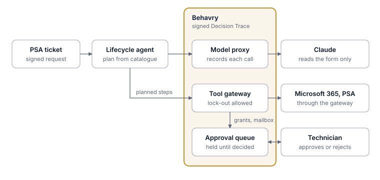

# Microsoft 365 User Lifecycle

**New starters and leavers for an MSP's clients, with every grant approved by a person.**

A hosted agent receives new-starter and leaver requests from the PSA, reads the
client's form with Claude, builds a plan from the MSP's own client catalogue,
and runs it through Behavry. A leaver is locked out at once; account creation,
mailbox conversion and licence removal wait for a technician. The plan and
every outcome are written on the ticket, and each request is one signed
Decision Trace.

| | |
| --- | --- |
| **Guide** | [guide.pdf](guide.pdf) (source: [guide.md](guide.md)) |
| **Code** | [agent/](agent/): Python, FastAPI, Anthropic SDK; 19 tests |
| **Policy** | [policies/](../../policies/): the gateway policy, with OPA tests |
| **Systems** | Microsoft 365, Halo PSA, an MCP gateway in front of them, Claude |
| **Behavry features** | Agent identity, model proxy, MCP gateway with per-tool policy, approval queue, run labels |

## What it shows

- **Speed where it protects, approval where it grants.** Blocking a leaver's
  sign-in runs immediately; creating an account waits for a person.
- **The model reads; the catalogue decides.** Claude turns a messy form into
  fixed fields. Licences, groups, domains and the user name come from the
  MSP's catalogue and code.
- **No cross-client mistakes.** Every address must be in the client's own
  domains, so a request cannot reach another tenant.
- **No passwords in transit.** The account is created with sign-in off and the
  password never leaves Microsoft 365.
- **Manipulated forms stop.** A form that tries to instruct the agent or asks
  for administrator rights changes nothing and is flagged for a person.

## Run it

See [agent/README.md](agent/README.md) for setup, the request format,
configuration and tests.
