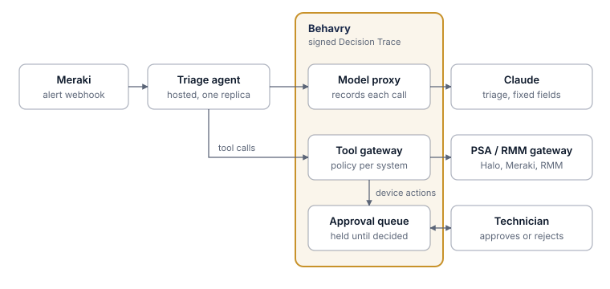

# Meraki Alert Triage

**A governed AI technician for managed service providers.**

A hosted agent receives Cisco Meraki alerts, triages them with Claude, writes a
structured note to the Halo PSA ticket, and asks a person before it touches a
device. Behavry sits in the path of every model call and tool call, so each
alert produces one signed Decision Trace: what the agent read, what it wrote,
what it tried to do, and who approved it.

| | |
| --- | --- |
| **Guide** | [guide.pdf](guide.pdf) (source: [guide.md](guide.md)) |
| **Code** | [agent/](agent/): Python, FastAPI, Anthropic SDK; 36 tests |
| **Policy** | [policies/](../../policies/): the gateway policy, with OPA tests |
| **Systems** | Cisco Meraki, Halo PSA, an MCP gateway in front of them, Claude |
| **Behavry features** | Agent identity, model proxy, MCP gateway with per-system policy, approval queue, run labels |

## What it shows

- **Noise handling first.** Duplicate alerts are dropped and a brief outage that
  recovers inside five minutes writes nothing.
- **Untrusted input, handled.** Alert text is fenced as data, the model returns
  fixed fields, and text that reads like an instruction is flagged and sent to
  a person.
- **Ask before acting.** A reboot request is held by Behavry until a technician
  approves or rejects it, and the outcome is written on the ticket either way.
- **One trace per alert.** A label on every call ties the webhook, the lookups,
  the model call, the notes and the approval together.

## Run it

See [agent/README.md](agent/README.md) for setup, configuration and tests.
