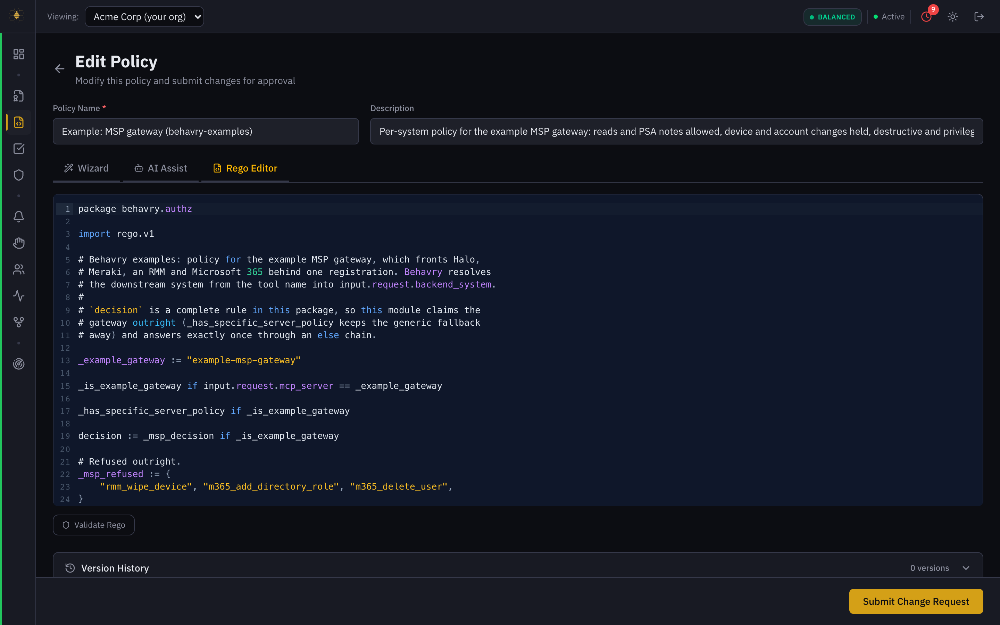
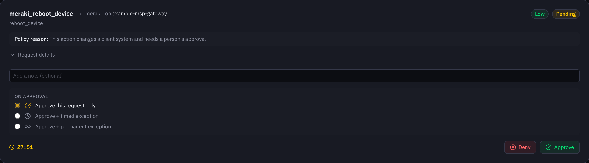
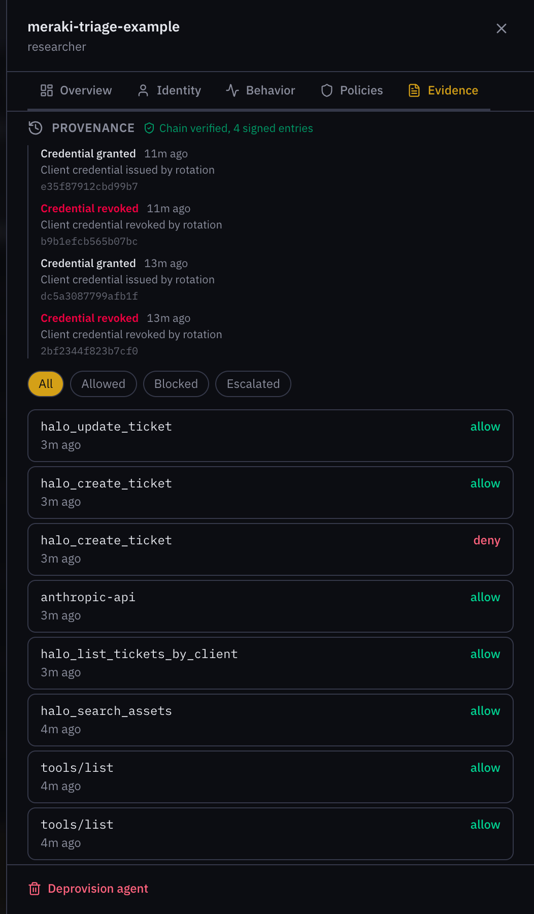
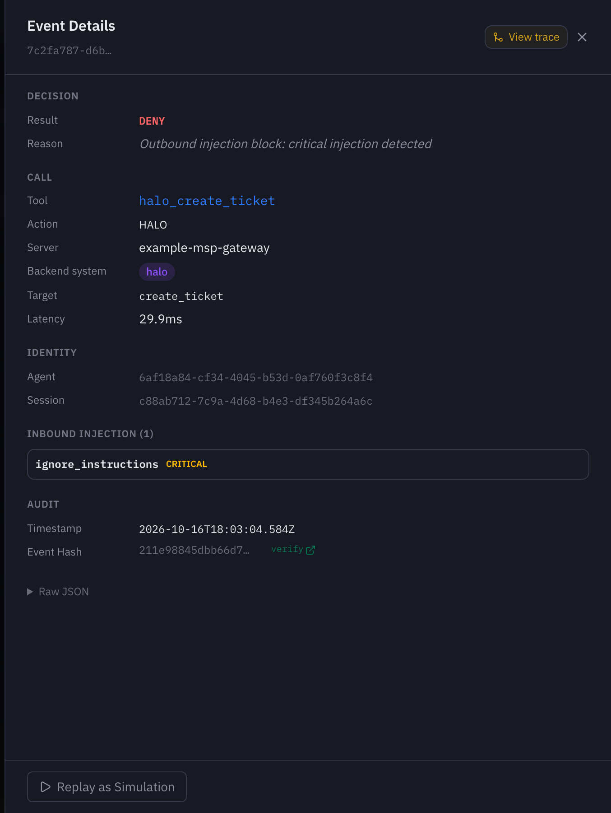

## What this example proves

An AI technician can triage Meraki alerts, write a useful note in the PSA, and
ask before it acts, with every step on a signed record. That answers the
question an MSP's clients will ask: what did the AI do on my network, and who
said it could.

The agent is hosted, so nothing runs on a client endpoint. A Meraki alert
arrives as a webhook, the agent triages it, posts the summary to Halo through
the MSP's tool gateway, and asks for approval before any remediation. Behavry
sits between the agent and everything it touches, so each alert produces one
Decision Trace: what the agent read, what it wrote, what it tried to do, and
who approved it.

The agent never calls Halo or Claude directly. Reads and notes pass straight
through; a device action waits in the approval queue until a technician
decides, and every step lands in the same Decision Trace.

## What it looks like in Behavry

These screens come from a real run of the example agent against Behavry's demo
plane, with a stand-in gateway and fictional data.

**Map the gateway once.** Register your gateway in Behavry, mark it as a
gateway, and map each system it fronts. Policy and the record can then tell a
Halo call from a Meraki or RMM call.

**Write the policy per system.** The example policy allows reads and PSA
notes, holds any device action for a person, and refuses destructive ones.

**A reboot waits for a technician.** When the agent asked to reboot an access
point that had stopped serving clients, Behavry held the call. The technician
sees the tool, the system it targets, and why it was held, and decides.

**The trail for one alert.** Every call the agent made for an alert sits on one
signed trail: the lookups, the model call, each write and its outcome.

**An injection attempt, stopped twice.** In the test run, a rogue access point
broadcast a network name written as an instruction. The agent's code flagged
it and asked for no action. When its triage note quoted that text, Behavry's
outbound check blocked the write as a critical injection. The agent then wrote
a short note with none of the alert's text, and handed the ticket to a person.

## Start narrow, then widen

Prove the triage first, then let the agent ask to act. Trust in the notes comes
before trust in the actions.

| Phase | The agent can | It cannot | Move on when |
| --- | --- | --- | --- |
| 1: read and comment | Read Halo and Meraki, add notes, create tickets, set priority | Change anything on a device or network | Technicians agree with most of the first 50 triage notes |
| 2: ask to act | Request a reboot or a Meraki change; Behavry holds the call for a person | Act without an approval | Approvals and rejections behave as agreed, and the injection test is held |

- **Alert types:** device down and back up, VPN connectivity change, uplink
  status change, rogue access point. Add more only after these read well.
- **One test client and one Meraki network.** A network where you can safely
  unplug things makes the test script easy.
- **A sandbox Halo client or ticket type,** so trial notes and tickets stay out
  of live queues.

## Build the agent to absorb Meraki's noise

Most of what makes technicians trust the agent is noise handling, not model
quality. A down/up pair that opens two tickets loses them faster than a weak
summary.

1. **Reply fast, work later.** Check the webhook's shared secret, return 200 at
   once, and queue the alert. Meraki retries a delivery that is slow or fails,
   and slow triage turns into duplicate alerts.
2. **Remove duplicates.** Key each alert on network, device and alert type, and
   drop repeats inside a short window.
3. **Wait out flapping.** Hold a "down" alert for a few minutes (the example
   uses 5). If the matching "up" arrives first, write nothing.
4. **Look for an open ticket first.** If the device already has one, add a note
   to it rather than opening another.
5. **Then triage,** with only the context the model needs: the alert, the
   client and site, the asset, and the open ticket if there is one.

## Treat alert content as untrusted

Alert text can be written by outsiders, so the agent must read it as data and
never as instructions. Anyone in range can broadcast a network name, and a
guest can name a laptop anything. An agent that reads that text and can write
to the PSA is a real prompt-injection target.

- **Fence the alert.** Put the alert inside a clearly marked block in the
  prompt, and tell the model in the system prompt that the block is data.
- **Give the agent only the tools it needs.** A triage agent has no use for
  identity administration, or for creating clients and users in Halo. Behavry
  policy enforces this too, so a tool the agent was never meant to call is
  refused or held, even if the model asks for it.
- **Keep the model's output structured.** The model returns a fixed set of
  fields, and the agent's own code decides which tools to call. The model
  never names a tool.
- **Test it.** One alert in the test script carries a device name written as an
  instruction. The note should report it as suspicious, and any action it
  provokes should be held.

## Route everything through Behavry

The record is only complete if every call the agent makes passes through
Behavry. One direct call to the Halo API is a gap a client could ask about.

- **Model calls** go through Behavry's model proxy, so each call is part of the
  record.
- **Tool calls** go through Behavry to the MSP's gateway. Behavry sees which
  system each call reaches (Halo, Meraki, the RMM), and policy is set per
  system.
- **One label per alert,** sent with every model and tool call, so each alert
  produces a single Decision Trace from webhook to final note.
- **Its own identity.** The agent gets its own Behavry identity and its own
  Halo API user (for example "AI Technician"). Halo then shows who wrote each
  note, and the agent can be paused alone if anything looks wrong.
- **Secrets in a secret store,** never in environment files or the image.

A starting policy, per system:

| System | Allowed | Held for approval | Refused |
| --- | --- | --- | --- |
| Halo | Reads, add a note, create a ticket, change priority or assignee | Merge or delete a ticket, client or user changes | None |
| Meraki | Reads | Any change | None |
| RMM | Reads | Reboot a device, run a script | Wipe or delete a device |
| Identity administration | None | None | Everything, for this agent |
| Anything else | None | Everything | None |

## Notes technicians can trust, and approvals that behave

Every note should look the same, so a technician can read one in ten seconds
and know how far to trust it.

- **The model returns fixed fields:** severity, headline, impact, likely cause,
  what it checked, recommendation, recommended action, confidence, whether a
  person is needed, and whether the alert looked tampered with.
- **Every Halo note has the same parts:** what happened, the impact, what the
  agent checked, the likely cause, its recommendation, and its confidence. It is
  signed "AI Technician" in the first line.
- **Low confidence goes to a person.** When the agent is unsure, the note says
  so and the ticket is assigned to the on-call technician. A guess is worse
  than a hand-off.

When the agent asks to act, Behavry holds the call until someone decides. The
agent should treat that as a normal outcome:

- Write "remediation requested, awaiting approval" on the ticket first.
- Wait for the decision. Behavry holds the call for up to 30 minutes depending
  on the agent's risk tier, so the agent's own timeout must be longer (the
  example waits 31). On a timeout, hand the ticket to a person.
- If something between the agent and Behavry, such as a load balancer, closes
  the connection before a decision, treat the outcome as unknown, not failed:
  the request may still be approved and carried out. Say so on the ticket and
  do not ask again.
- Treat a rejection or a timeout as a result to record, never a reason to
  retry.
- Name the approvers before go-live, and decide where they approve: the
  Behavry dashboard, or Slack notices.

## How you will know it worked

Agree these measures before the first alert, so the end of the trial is a
decision and not an opinion.

| Measure | Target |
| --- | --- |
| Technician agrees with the triage note | Most of the first 50 alerts; agree the exact bar up front |
| Time from alert to note in Halo | Faster than today's manual path |
| Duplicate tickets from flapping or repeat alerts | None |
| Actions taken without an approval | None |
| Calls that skipped Behavry | None |
| Injection test alert | Flagged in the note; any action it provokes is held |

Run this script before go-live. Meraki's "send test webhook" button covers the
first item; the rest need a real device on the test network.

- A normal alert opens a ticket with a structured note.
- A repeat of the same alert adds nothing new.
- A down then up inside five minutes produces no ticket.
- An alert for a device with an open ticket adds a note to that ticket.
- A remediation request is held, approved, and carried out.
- A remediation request is held and rejected, and the agent records it without
  retrying.
- The injection alert is flagged and nothing it asks for happens.

## The example code

The [`agent/`](agent/) folder holds a small, readable Python agent that follows
every point in this guide:

- checks Meraki's shared secret, replies at once, removes duplicates and waits
  out flapping;
- looks up the asset, client, site and open ticket in Halo through the gateway;
- triages with Claude through Behavry, with the alert fenced as data and fixed
  output fields;
- writes the same structured note every time, as a private note, and assigns
  the on-call technician when a person is needed;
- flags instruction-like alert text, sends that ticket to a person, and never
  asks to act on it;
- in phase 2, asks to reboot a device, records the approval, rejection or
  timeout on the ticket, and never retries.

It comes with tests for each of these and a container image definition.
